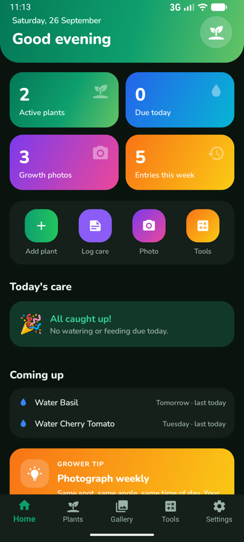
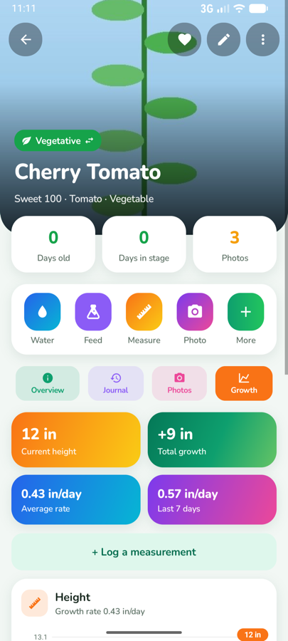
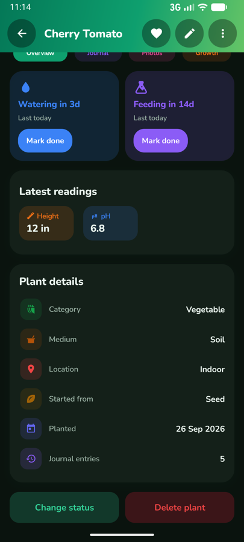
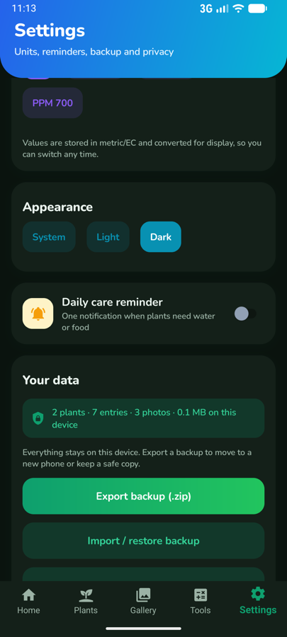

<p align="center">
  
</p>

<h1 align="center">PlantHelper</h1>

<p align="center">
  A private plant-growing journal: watering, feeding, measurements, climate and growth photos for every plant.<br>
  <strong>No account. No ads. No tracking. No internet permission.</strong>
</p>

<p align="center">
  <a href="https://supunsarachitha.github.io/PlantHelper/">Website</a> ·
  <a href="https://supunsarachitha.github.io/PlantHelper/privacy.html">Privacy policy</a> ·
  <a href="CHANGELOG.md">Changelog</a>
</p>

<p align="center">
  
  
  
  
</p>

## Features

- **Plants** – a searchable, filterable list with category, growth stage, medium, location, source and status for each plant.
- **Care journal** – ten entry types: water, feed, measure, environment, pest, training, transplant, harvest, stage change and note. Entries capture details such as pH, EC, runoff, nutrient doses, height, temperature, humidity and PPFD.
- **Care schedule** – per-plant watering and feeding intervals, a "today's care" list with one-tap *Mark done*, and an optional daily reminder notification.
- **Growth photos** – take a photo or pick one with the system photo picker, then browse the gallery or compare before and after. Stored copies have location (EXIF/GPS) data removed.
- **Growth charts** – height over time, total growth, average rate and the rate over the last 7 days.
- **Grower tools** – VPD, daily light integral (DLI), PPM ↔ EC conversion, a nutrient mixer, a unit converter and a nutrient library.
- **Your data, your copy** – export a backup (`.zip`) or the journal (`.csv`), restore by merging or replacing, and delete everything from Settings.
- **Units and appearance** – metric or imperial, °C or °F, EC or PPM 500/640/700, and light, dark or system theme.

## Privacy

Everything is stored in the app's private storage on the device. The Android build requests no internet permission, and Android cloud backup is turned off for app data. The only permissions are camera (when you take a photo), notifications (if you turn the reminder on) and run-at-startup (to restore that reminder after a restart).

The full policy is in [PRIVACY_POLICY.md](PRIVACY_POLICY.md) and published at <https://supunsarachitha.github.io/PlantHelper/privacy.html>.

## Platforms

| Platform | Minimum version |
|---|---|
| Android | 7.0 (API 24) |
| iOS | 15.0 |
| Mac Catalyst | 15.0 |
| Windows | 10, version 1809 |

Android is the primary target and the one prepared for Google Play. Daily reminders are implemented for Android, iOS and Mac Catalyst.

## Project layout

```
src/PlantHelper.Core/    Models, SQLite repositories, schedule, analytics, calculators, backup (plain .NET 10)
src/PlantHelper/         .NET MAUI app: views, view models, platform code
tests/PlantHelper.Tests/ xUnit tests for the core library
docs/                    GitHub Pages site, screenshots and store assets
```

The core library has no MAUI dependency, so its logic is tested without a device or emulator.

## Build and run

You need the [.NET 10 SDK](https://dotnet.microsoft.com/download) and the MAUI workload:

```sh
dotnet workload install maui
```

Android builds also need the Android SDK; iOS and Mac Catalyst builds need Xcode on a Mac.

Run on a connected Android device or emulator:

```sh
dotnet build src/PlantHelper/PlantHelper.csproj -f net10.0-android -t:Run
```

For other platforms, replace the framework with `net10.0-ios`, `net10.0-maccatalyst` or `net10.0-windows10.0.19041.0`.

## Tests

```sh
dotnet test tests/PlantHelper.Tests/PlantHelper.Tests.csproj
```

## Release build for Google Play

This makes a signed `.aab` for Google Play and a signed `.apk` for direct installs and for testing the release build:

```sh
rm -rf src/PlantHelper/bin/Release src/PlantHelper/obj/Release
dotnet publish src/PlantHelper/PlantHelper.csproj -c Release -f net10.0-android
# Output: src/PlantHelper/bin/Release/net10.0-android/publish/
```

Release signing is set up in `src/PlantHelper/signing.local.props`, which is git-ignored. Copy [signing.local.props.example](src/PlantHelper/signing.local.props.example), fill in your keystore's details, and never commit a keystore or its passwords. Without that file, a release build is signed with the debug key, which no store accepts.

Build a release from clean, as above: an incremental build can keep old R8-shrunk Java code in the package.

Before each Play upload, increase `ApplicationVersion` (the version code) in [src/PlantHelper/PlantHelper.csproj](src/PlantHelper/PlantHelper.csproj). `ApplicationDisplayVersion` is the version users see.

## Website

The site in [docs/](docs/) is plain HTML and CSS with no build step. To publish it, open the repository's **Settings → Pages**, choose **Deploy from a branch**, and select the `main` branch with the `/docs` folder.

[docs/privacy.html](docs/privacy.html) mirrors [PRIVACY_POLICY.md](PRIVACY_POLICY.md); change both together.

## License

PlantHelper is source-available under the [PolyForm Noncommercial License 1.0.0](LICENSE). You may use, modify and share it for any noncommercial purpose. Commercial use is not covered by this license.

Third-party fonts and libraries are listed in [THIRD-PARTY-NOTICES.md](THIRD-PARTY-NOTICES.md).

Copyright © 2026 Supun Sarachitha
